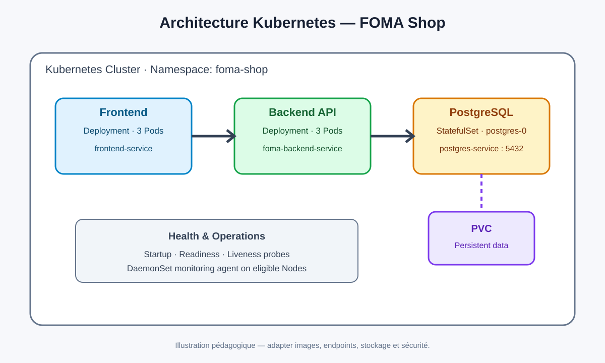
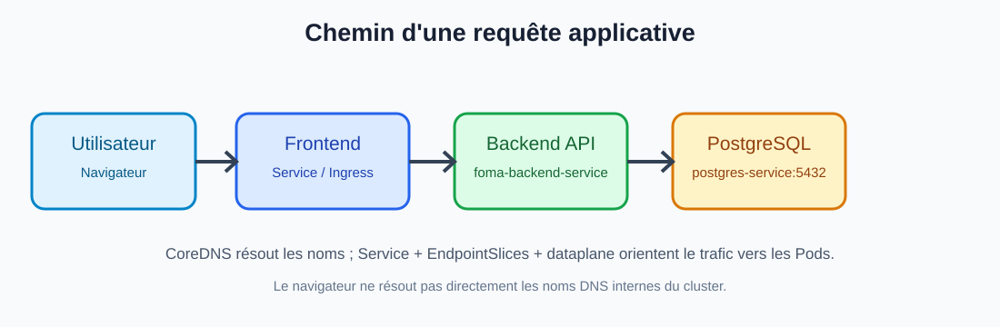
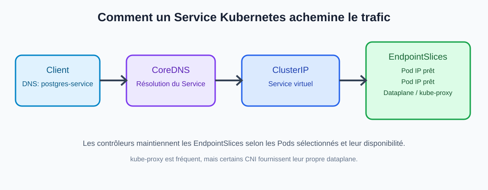

# Kubernetes en profondeur — cours pratique DevOps

**FOMA — Foundation of Mastering Automation | William Foma**



## Objectifs pédagogiques

À la fin de cette leçon, l'apprenant doit pouvoir expliquer et pratiquer :
- les Pods et les contrôleurs Deployment, StatefulSet et DaemonSet ;
- les labels, selectors et Pod templates ;
- startupProbe, readinessProbe et livenessProbe ;
- PersistentVolume, PersistentVolumeClaim et volumeClaimTemplates ;
- les Services ClusterIP et headless ;
- le DNS Kubernetes, CoreDNS, EndpointSlices et le dataplane réseau ;
- le parcours d'une requête Frontend → Backend → PostgreSQL ;
- le diagnostic des pannes avec kubectl.

## 1. Architecture du laboratoire

Nous déployons trois composants indépendants :
1. **Frontend** : interface Web Next.js.
2. **Backend** : API Node.js.
3. **PostgreSQL** : base de données.

Frontend et Backend sont des applications généralement stateless : un Deployment peut gérer plusieurs Pods interchangeables. PostgreSQL conserve un état durable : nous utilisons un StatefulSet et un volume persistant. Chaque couche possède un Service stable.



Ne placez pas automatiquement toute l'application dans un seul Pod. Des composants indépendants ont des besoins de mise à l'échelle, de disponibilité, de sécurité et de cycle de vie différents. Un Pod multi-conteneurs est plutôt adapté aux conteneurs étroitement couplés qui partagent le même cycle de vie, le réseau et éventuellement des volumes (par exemple un sidecar de logs).

## 2. Pod : unité de déploiement

Un Pod contient un ou plusieurs conteneurs planifiés ensemble sur un Node. Les conteneurs d'un même Pod partagent l'espace réseau : ils peuvent communiquer via localhost. Ils peuvent aussi partager des volumes. Les Pods sont éphémères : leur IP peut changer après recréation.

Un Pod n'est ni une VM ni un contrôleur de réplication. Pour maintenir le nombre désiré de Pods, on utilise des contrôleurs comme Deployment ou StatefulSet.

## 3. Deployment : gérer les applications stateless

Un Deployment déclare l'état désiré d'une application : nombre de réplicas, template de Pod et stratégie de mise à jour. Le contrôleur Deployment gère un ReplicaSet, qui maintient le nombre de Pods demandé.

Extrait :

```yaml
apiVersion: apps/v1
kind: Deployment
metadata:
  name: foma-backend
spec:
  replicas: 3
  selector:
    matchLabels:
      app: foma-backend
  template:
    metadata:
      labels:
        app: foma-backend
    spec:
      containers:
        - name: backend
          image: ghcr.io/ORG/foma-backend:1.0.0
          ports:
            - containerPort: 8080
```

Explication :
- `apiVersion` indique le groupe/version de l'API Kubernetes.
- `kind` choisit le type d'objet.
- `metadata.name` donne son nom.
- `spec.replicas: 3` exprime le nombre désiré de Pods.
- `selector.matchLabels` indique au contrôleur quels Pods lui appartiennent.
- `template` décrit les Pods à créer.
- Les labels du template doivent correspondre au selector.

Si un Pod est supprimé, le ReplicaSet constate que le nombre réel est inférieur au nombre désiré et en crée un autre. Les Pods sont interchangeables ; ne construisez pas votre architecture autour de leur IP individuelle.

## 4. StatefulSet : identité et stockage stables

Un StatefulSet convient aux applications nécessitant une identité stable, un ordre de démarrage/arrêt ou un stockage persistant par identité. Ses Pods portent des noms ordinaux : postgres-0, postgres-1, etc.

Le champ `serviceName` référence habituellement un Headless Service. `volumeClaimTemplates` demande un PVC distinct pour chaque Pod ordinal. Si postgres-0 est recréé, le StatefulSet peut rattacher le PVC correspondant et le Pod retrouve ses données, sous réserve du bon fonctionnement du stockage et de sa politique.

**Attention :** StatefulSet ne configure pas à lui seul la réplication PostgreSQL, le failover, le quorum, la sauvegarde ou la haute disponibilité. Notre laboratoire démarre PostgreSQL avec un seul replica pour expliquer le mécanisme de stockage.

## 5. DaemonSet : un agent par Node éligible

Un DaemonSet veille à ce qu'un Pod soit présent sur chaque Node qui correspond aux règles de placement et aux tolérances. Il est courant pour les agents de logs, de monitoring, de réseau ou de sécurité.

Il n'a généralement pas de champ replicas. Le contrôleur DaemonSet observe les Nodes et crée les Pods requis. Lorsqu'un nouveau Node rejoint le cluster, un Pod est automatiquement créé dessus s'il est éligible.

Le selector identifie les Pods gérés ; le template décrit le Pod à créer. Ce n'est pas une ligne YAML spéciale « nouveau nœud » : c'est le contrôleur DaemonSet qui surveille l'état du cluster et réconcilie les Pods avec les Nodes éligibles.

## 6. Comparaison des contrôleurs

| Objet | Usage | Identité | Stockage |
|---|---|---|---|
| Deployment | API, Frontend stateless, workers | Pods interchangeables | À définir séparément |
| StatefulSet | Base de données, systèmes stateful | Identité ordinale stable | PVC par Pod possible |
| DaemonSet | Agent sur les Nodes | Un Pod par Node éligible | Dépend de l'agent |

## 7. Labels et selectors : relier les ressources

Un label est une paire clé/valeur, par exemple `app: foma-backend`. Le selector du Deployment sélectionne ses Pods. Le selector du Service sélectionne les Pods vers lesquels il envoie le trafic.

Le selector ne crée pas les Pods. Le template les décrit. Les labels créent le lien logique entre le contrôleur et ses Pods ou entre un Service et ses endpoints. Une faute de frappe dans un label peut produire un Service sans endpoint.

## 8. Health checks : les trois probes

Les probes sont définies dans la section de chaque conteneur. Chaque conteneur peut posséder ses propres probes.

### 8.1 Startup Probe

Elle laisse le temps à une application lente de terminer son initialisation. Tant qu'elle n'a pas réussi, Kubernetes ne lance pas les contrôles liveness et readiness pour ce conteneur. Elle évite qu'une application lente soit redémarrée trop tôt.

### 8.2 Readiness Probe

Elle répond à la question : « ce conteneur est-il prêt à recevoir du trafic ? » Si elle échoue, le Pod est marqué non prêt et n'est normalement plus publié comme endpoint prêt par le Service. Cela ne redémarre pas le conteneur à lui seul.

### 8.3 Liveness Probe

Elle répond à la question : « le conteneur fonctionne-t-il encore correctement, ou est-il bloqué ? » Si les échecs dépassent le seuil, le kubelet redémarre le conteneur concerné selon la politique de redémarrage du Pod. Le Node entier n'est pas redémarré. Les autres conteneurs du Pod ne sont pas automatiquement redémarrés par la seule liveness probe de ce conteneur.

Une liveness probe ne doit pas échouer simplement parce qu'une dépendance externe est indisponible : cela peut provoquer des redémarrages en cascade. Elle doit vérifier un état local qui justifie réellement un redémarrage.

### 8.4 Exemple

```yaml
startupProbe:
  httpGet:
    path: /health/startup
    port: 8080
  periodSeconds: 5
  failureThreshold: 24
livenessProbe:
  httpGet:
    path: /health/live
    port: 8080
  periodSeconds: 10
  timeoutSeconds: 2
  failureThreshold: 3
readinessProbe:
  httpGet:
    path: /health/ready
    port: 8080
  periodSeconds: 5
  timeoutSeconds: 2
  failureThreshold: 3
```

Les endpoints doivent réellement exister dans votre application. Kubernetes propose notamment les checks HTTP, TCP, exec et gRPC. Startup, readiness et liveness n'ont pas le même objectif : « démarrer », « recevoir du trafic », « redémarrer si bloqué ».

## 9. Stockage persistant : PV, PVC et StorageClass

- **PV (PersistentVolume)** : ressource de stockage mise à disposition du cluster.
- **PVC (PersistentVolumeClaim)** : demande de stockage par une application.
- **StorageClass** : décrit comment le stockage peut être provisionné.
- **volumeMounts** : monte le volume dans le système de fichiers du conteneur.

Les données PostgreSQL doivent être écrites sur le volume monté, pas uniquement dans la couche éphémère du conteneur. Le PVC n'est pas une sauvegarde : configurez des backups, le chiffrement, la rétention et testez les restaurations. La disponibilité et les modes d'accès dépendent du fournisseur de stockage.

## 10. Services : la communication entre Pods

Un Service fournit un point d'accès stable à un ensemble de Pods sélectionnés par labels. Le Backend ne doit pas coder en dur l'IP de postgres-0. Il se connecte à `postgres-service:5432`.

### ClusterIP

Type par défaut. Le Service fournit une IP virtuelle stable, accessible depuis le cluster. Ici, `postgres-service` cible les Pods PostgreSQL. `foma-backend-service` cible les Pods Backend.

### Headless Service

Un Service avec `clusterIP: None` ne fournit pas de ClusterIP virtuelle. Il est utilisé par le StatefulSet pour donner des identités DNS stables aux Pods, par exemple :

`postgres-0.postgres-headless.foma-shop.svc.cluster.local`

Le backend utilisera plutôt le Service normal `postgres-service` pour joindre la base.

## 11. DNS, CoreDNS, EndpointSlices et kube-proxy

### DNS / CoreDNS

CoreDNS résout les noms des Services. Dans le même namespace, le backend peut utiliser `postgres-service`. Depuis un autre namespace, le nom complet est `postgres-service.foma-shop.svc.cluster.local`.

### EndpointSlices

Les EndpointSlices représentent les adresses des Pods associés à un Service et leur état de disponibilité. Quand un Pod devient non prêt ou disparaît, les contrôleurs actualisent les endpoints correspondants.

### kube-proxy / dataplane

Dans de nombreuses installations, kube-proxy observe Services et EndpointSlices et programme les règles réseau du Node (iptables ou IPVS selon le mode). Le trafic vers une ClusterIP est alors dirigé vers un endpoint. Certains clusters utilisent un dataplane CNI qui remplace kube-proxy : le détail d'implémentation varie, mais le Service reste l'abstraction stable.



## 12. Parcours d'une requête de bout en bout

1. L'utilisateur ouvre l'interface Frontend.
2. Le Frontend appelle le Backend.
3. L'appel arrive au Service `foma-backend-service`.
4. Le dataplane dirige le trafic vers un Pod Backend prêt.
5. Le Backend interroge PostgreSQL via `postgres-service:5432`.
6. Le Service PostgreSQL dirige la connexion vers le Pod PostgreSQL.
7. La réponse revient au Backend puis au Frontend.

**Nuance Next.js :** si l'appel API est exécuté dans le navigateur, celui-ci ne peut pas résoudre le DNS interne Kubernetes. Exposez l'API par Ingress/URL accessible ou effectuez l'appel côté serveur Next.js depuis le cluster.

Un Service ne conserve pas une connexion TCP ouverte à travers le redémarrage d'un Pod. L'adresse du Service reste stable, mais les connexions existantes peuvent tomber. Le client Backend doit gérer les erreurs, délais d'attente et reconnexions.

## 13. Déploiement du laboratoire

Prérequis : cluster Kubernetes, kubectl, StorageClass fonctionnelle pour le PVC, images applicatives publiées et endpoints health implémentés. Ingress nécessite un contrôleur Ingress.

```bash
kubectl apply -f k8s/00-namespace.yaml
kubectl apply -f k8s/01-postgres-secret.example.yaml
kubectl apply -f k8s/02-postgres-headless-service.yaml
kubectl apply -f k8s/03-postgres-service.yaml
kubectl apply -f k8s/04-postgres-statefulset.yaml
kubectl rollout status statefulset/postgres -n foma-shop
kubectl apply -f k8s/05-backend-deployment.yaml
kubectl apply -f k8s/06-backend-service.yaml
kubectl apply -f k8s/07-frontend-deployment.yaml
kubectl apply -f k8s/08-frontend-service.yaml
```

Remplacez `ghcr.io/ORG/foma-backend:1.0.0` et `ghcr.io/ORG/foma-frontend:1.0.0` par vos vraies images. Le backend doit écouter sur 8080 et le frontend sur 3000 selon les exemples. Implémentez les chemins de santé référencés dans les manifestes.

Le Secret fourni est un exemple local uniquement. Ne commitez jamais de vrais mots de passe. En production, utilisez un gestionnaire de secrets et une méthode de livraison sécurisée.

## 14. Vérification et diagnostic

```bash
kubectl get all -n foma-shop
kubectl get pods -n foma-shop -o wide
kubectl get pvc -n foma-shop
kubectl get svc,endpointslices -n foma-shop
kubectl get pods -n foma-shop --show-labels
kubectl describe pod <pod-name> -n foma-shop
kubectl logs <pod-name> -n foma-shop
kubectl logs <pod-name> -n foma-shop --previous
kubectl get events -n foma-shop --sort-by=.metadata.creationTimestamp
kubectl get storageclass
kubectl describe pvc <pvc-name> -n foma-shop
```

| Symptôme | Pistes de diagnostic |
|---|---|
| Pod Pending | PVC, capacité, requests, taints, scheduling |
| CrashLoopBackOff | logs --previous, commande, probes, configuration |
| Readiness échoue | endpoint, port, délais, dépendances |
| PVC Pending | StorageClass, provisioner, capacité |
| Service sans endpoints | selector et labels, readiness |
| DNS ne résout pas | nom, namespace, CoreDNS, configuration DNS |

## 15. Scénarios de panne à comprendre

**Liveness échoue sur Backend :** kubelet sur le Node concerné exécute la probe. Après le seuil, il redémarre le conteneur Backend. Les autres conteneurs du Pod ne sont pas redémarrés par cette seule probe. Les autres réplicas Backend continuent de servir s'ils sont prêts.

**Un Pod Backend disparaît :** le ReplicaSet crée un Pod de remplacement. Son IP peut changer. Le Service sélectionne les Pods portant le label attendu et les EndpointSlices sont actualisés.

**postgres-0 est supprimé :** le StatefulSet recrée l'identité postgres-0. Le PVC associé est normalement conservé et réutilisé selon la configuration du stockage et les politiques de rétention. Le Backend peut perdre ses connexions actives et doit se reconnecter.

**Un nouveau Node rejoint le cluster :** le contrôleur DaemonSet détecte le Node. Si les règles de placement et tolérances l'autorisent, un Pod DaemonSet est créé dessus.

## 16. DaemonSet de monitoring

Le manifeste optionnel node-exporter illustre un agent de métriques au niveau Node. Il utilise hostNetwork, hostPID et un montage hostPath : ces accès sont sensibles. N'appliquez pas ce fichier aveuglément en production. Examinez les politiques de sécurité, le port hostPort, les permissions et les besoins de collecte.

```bash
kubectl get daemonset -n foma-shop
kubectl get pods -n foma-shop -o wide
kubectl describe daemonset node-exporter -n foma-shop
```

## 17. Bonnes pratiques production

1. Définir requests et limits réalistes.
2. Utiliser des tags d'image immuables ou des digests.
3. Ne pas stocker de secrets dans Git.
4. Configurer des probes pertinentes et éviter les checks trop agressifs.
5. Séparer les responsabilités Frontend, Backend et base de données.
6. Ajouter NetworkPolicies selon le CNI.
7. Sauvegarder PostgreSQL et tester les restaurations.
8. Définir explicitement la stratégie HA de la base de données.
9. Surveiller les ressources, logs et événements.
10. Tester les déploiements, rollbacks et scénarios de panne.

## 18. Questions de révision / entretien

1. Quelle différence entre Deployment et StatefulSet ?
2. Pourquoi un DaemonSet n'a-t-il généralement pas replicas ?
3. Qu'est-ce qui relie un Service aux Pods ?
4. Que se passe-t-il lorsqu'une readiness probe échoue ?
5. Quelle différence entre liveness et startup ?
6. Qui exécute les probes sur chaque Node ?
7. Quel conteneur redémarre si sa liveness échoue ?
8. Pourquoi ne pas utiliser l'IP d'un Pod pour joindre PostgreSQL ?
9. Quel est le rôle du Headless Service dans un StatefulSet ?
10. À quoi servent les EndpointSlices ?
11. Est-ce qu'un StatefulSet assure automatiquement le failover PostgreSQL ?
12. Pourquoi le navigateur ne résout-il pas un DNS interne Kubernetes ?
13. Une connexion TCP existante survit-elle au redémarrage du Pod cible ?
14. Comment vérifier pourquoi un PVC reste Pending ?

## Conclusion

La maîtrise de Kubernetes ne consiste pas à mémoriser des fichiers YAML. Il faut comprendre l'état désiré, les contrôleurs qui le réconcilient, les probes, le stockage et le dataplane réseau. Entraînez-vous à expliquer non seulement ce que fait chaque ressource, mais aussi ce qui se passe quand une ressource échoue.

---

**Foundation of Mastering Automation (FOMA)**  
Trainer: **William Foma**  
https://www.foma.life

#FOMA #DevOps #Kubernetes #DevSecOps #CloudNative
